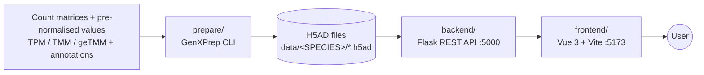

<div align="center">

# 🧬 GenXBrowser

**Interactive cross-species gene-expression browser for comparative transcriptomics.**

[](LICENSE)
[](https://www.python.org/)
[](https://nodejs.org/)
[](https://vuejs.org/)
[](https://flask.palletsprojects.com/)
[](frontend/package.json)

</div>

GenXBrowser turns AnnData (`.h5ad`) gene-expression matrices into an interactive web application: 📊 heatmaps with hierarchical clustering, ⚡ instant filtering on gene and sample metadata, Gene-Ontology lookup, Over-Representation Analysis (ORA), phylogenetic gene-tree viewing, and side-by-side cross-species comparison.

## 🔭 Macro Workflow



Each stage is independent: [GenXPrep](prepare/README.md) validates and packages the provided expression matrices (raw counts and, where available, pre-computed normalised values such as TPM, TMM or geTMM) together with all supplied metadata (sample mappings, GO terms, etc.) into H5AD files, embedding them in `.obs` and `.var` accordingly. The backend serves the resulting H5AD files read-only, and the frontend is a static SPA that talks to the backend over `/api/*`.

## ⚡ Quick Start

GenXBrowser ships with a single launcher that provisions both services from one config file.

```bash
# 1. Install the data-prep CLI (creates the `genxprep` conda env)
cd prepare/
conda env create -f environment.yml
conda activate genxprep

# 2. Describe your inputs and build H5AD files
genxprep init                  # writes config.yml template
# …edit config.yml to point at your TSV / FASTA inputs…
genxprep build config.yml      # validates + writes data/

# 3. Launch backend + frontend
genxprep app config.yml
```

Open <http://localhost:5173>. `Ctrl+C` stops both services. After the first run, use `genxprep app config.yml --skip-setup` to bypass dependency installation, and `--backend-port` / `--frontend-port` to change ports.

Input file formats, the full `config.yml` schema, and validation diagnostics are documented in [prepare/README.md](prepare/README.md).

### Container Images

The `backend/` and `frontend/` directories each provide a `Dockerfile` (`python:3.12-slim` + gunicorn for the API, `node:20-alpine` → `nginx:stable-alpine` for the SPA). They are built and run independently; a sample mount layout for binding a prepared `data/` directory into the backend is available in [prepare/data/docker-compose.override.yml](prepare/data/docker-compose.override.yml).

## 🧪 What's Inside

- **Catalog** - multi-select species/datasets for comparative views.
- 📊 **Heatmap** - Plotly heatmap with z-score normalisation, hierarchical clustering (client- or server-side), row/column annotations and configurable colour scales.
- ⚡ **Advanced Filtering** - text, numeric, boolean and array filters on `.var` (gene) and `.obs` (sample) metadata; URL-shareable filter hashes via `POST /api/id`.
- **GO Term Search & ORA** - autocomplete over `go-basic.obo`, Fisher's exact test with Benjamini–Hochberg FDR on filtered gene sets.
- 🌳 **Phylogenetic Trees** - Newick gene-family trees rendered with phylotree + D3.
- **Cross-Species Comparison** - box plots of orthologous expression across selected species.
- 🤖 **AI Assistant** *(opt-in)* - chat panel that reads the live UI state and proposes one-click filter / view changes. Activates only when `LLM_API_BASE`, `LLM_API_KEY` and `LLM_MODEL` are set on the backend.
- **Admin Panel** - runtime config editing at `/admin`, optionally protected by `ADMIN_TOKEN`.

## ⚙️ Runtime Configuration

The backend auto-discovers `.h5ad` files inside `H5AD_DATA_DIR` on first startup and writes `config/project_config.json`. All subsequent changes can be made through the Admin UI or the REST API - no rebuild required.

Frontend branding lives in [frontend/public/genxbrowser_config.yaml](frontend/public/genxbrowser_config.yaml) and is fetched at runtime: edit the file and reload the page.

Key backend environment variables (set automatically by `genxprep app`):

| Variable | Purpose | Default |
|---|---|---|
| `H5AD_DATA_DIR` | Directory containing per-species `.h5ad` files | *(required)* |
| `PROJECT_CONFIG_PATH` | Project config JSON | `$H5AD_DATA_DIR/config/project_config.json` |
| `FILTER_STORE_PATH` | Content-addressed filter hashes | `$H5AD_DATA_DIR/filters` |
| `GO_OBO_PATH` | Gene Ontology OBO file | `$H5AD_DATA_DIR/go-basic.obo` |
| `GO_AUTO_DOWNLOAD` | Download OBO when missing | `true` |
| `SPECIES_PHOTOS_DIR` | Optional species thumbnails | *(unset)* |
| `ADMIN_TOKEN` | Bearer token gating `/api/admin/*` | *(unset → admin auth off)* |

The complete environment variable list, including the LLM-assistant configuration, lives in [backend/README.md](backend/README.md).

## 📁 Repository Layout

```
GenXBrowser/
├── prepare/    GenXPrep CLI – validates raw data, emits the H5AD bundle
├── backend/    Flask REST API serving H5AD files (no database)
├── frontend/   Vue 3 SPA – the GenXBrowser user interface
└── LICENSE
```

## 📜 License

Released under the [MIT License](LICENSE).
