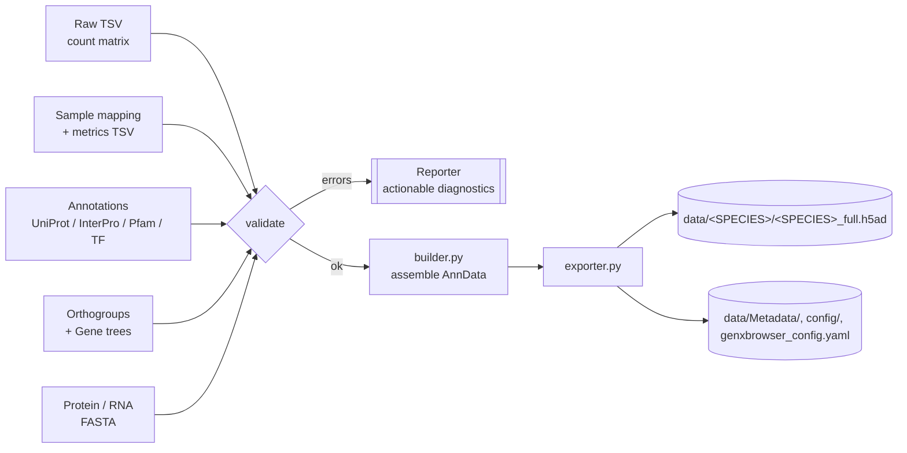

# 🧪 GenXPrep - Data Preparation for GenXBrowser

[](https://www.python.org/)
[](../LICENSE)

GenXPrep is the CLI that validates raw expression inputs and converts them into the H5AD bundle consumed by [GenXBrowser](../README.md). It is the single entry point you need before running the application - `genxprep build` produces the `data/` directory, and `genxprep app` then launches the full stack against it.

## ⚙️ Install

```bash
cd prepare/
conda env create -f environment.yml   # creates the `genxprep` env (Python 3.12 + Node)
conda activate genxprep
# or, into an existing Python 3.12 env:
pip install -e .
```

The conda environment is the supported path because it also provides `nodejs`, which `genxprep app` needs to bootstrap the frontend.

## 🔁 Preparation Pipeline



Every command (`init`, `validate`, `build`, `app`) is a thin wrapper around this pipeline. `validate` short-circuits before `builder.py` runs, so you can iterate on inputs without writing any output.

## 📥 Input Data

### Required

| File | Format | Notes |
|---|---|---|
| **Count matrix** | TSV, first column = gene ID, remaining columns = sample IDs with numeric values | At least one matrix per species. **Raw integer counts are fully supported** - they do not need to be pre-normalised. |

### Optional - additional layers and annotations

| File | Format |
|---|---|
| Normalised matrices (`tpm`, `tmm`, `getmm`) | Same shape as the count matrix; stored as additional H5AD layers |
| Sample mapping | TSV with a `Sample` column plus arbitrary metadata columns (`trait`, `condition`, `batch`, …) |
| RNA-seq metrics | TSV columns: `sample`, `assigned`, `pct unmapped`, `pct no_feature`, `pct trimmed` |
| Orthogroups | TSV with `Orthogroup` + one column per species (comma-separated gene IDs) |
| Gene trees | TXT, one entry per line: `OG_ID:newick_string` |
| UniProt annotations | TSV: `ID`, `Description`, `Genename`, `GO`, `ECNumber`, … |
| InterPro / Pfam | Headerless TSV, 3 columns: gene ID, accession, description |
| Transcription factors | TSV: `Gene`, `Family` |
| Protein / RNA FASTA | Standard FASTA, IDs must match the count matrix |

> ⚠️ **Gene IDs must be consistent across every input file.** If the count matrix uses `Aqcoe0008s0001.v3.1`, then UniProt, InterPro, Pfam, TF and FASTA files must use exactly the same identifiers. Mismatches are reported with concrete examples from both files.

> ⚠️ **Excel destroys gene names.** Re-exports of `MARCH1`, `SEPT2` and similar are silently converted to dates. Always export TSVs directly from the source pipeline, never via Excel.

### Matrix Normalisation

GenXPrep treats normalisation as data, not as a step it performs. Provide whichever matrices you already have - raw counts, CPM, TPM, TMM, geTMM - and each one is stored as a layer on the AnnData object so the frontend can switch between them at runtime via *Expression display*. The first matrix listed under `species.<code>.matrix` becomes `.X`; the rest are written as `.layers["<name>"]`.

## 📝 Config File

`genxprep init` writes a fully commented `config.yml`. The structural skeleton is:

```yaml
project:
  name: "My Project"            # required
  output_dir: ./data             # required
  # root_dir: ~/projects/MyProject/Input   # optional; resolves relative paths

global_metadata:                 # shared across species, all optional
  orthogroups: path/to/Orthogroups.tsv
  gene_trees:  path/to/Resolved_Gene_Trees.txt

species:
  AC:                            # species code: 2–10 uppercase letters
    name: "Aquilegia coerulea"
    matrix:                      # at least ONE matrix is required
      raw:   path/to/raw_counts.tsv
      tpm:   path/to/tpm.tsv     # optional
      tmm:   path/to/tmm.tsv     # optional
      getmm: path/to/getmm.tsv   # optional
    sample_mapping: path/to/mapping.tsv   # optional
    metrics:        path/to/metrics.tsv   # optional
    metadata:                              # all optional
      uniprot:  path/to/uniprot.tsv
      interpro: path/to/interpro.tsv
      pfam:     path/to/pfam.tsv
      tf:       path/to/tf.tsv
    sequences:                             # optional
      protein: path/to/protein.fas
      rna:     path/to/rna.fas
```

Sample mapping columns are generic. During build, GenXPrep preserves the metadata column names in `.obs`; if your mapping or upstream H5AD marks a preferred sample column, the generated project config stores it as `default_trait_column`. Otherwise the role can be selected later in the Admin Panel.

> All paths are resolved relative to `root_dir`, or - if `root_dir` is unset - relative to the directory containing `config.yml`. Absolute paths and `~` expansion are both supported.

## 📤 Output Layout

After `genxprep build config.yml`, the `output_dir` looks like:

```
data/
├── AC/
│   └── AC_full.h5ad           # one bundle per species: .X, .layers, .var, .obs, .uns
├── PS/
│   └── PS_full.h5ad
├── Metadata/
│   ├── fas/
│   │   ├── AC.protein.fas
│   │   └── AC.RNA.fas
│   └── Resolved_Gene_Trees.txt
├── config/
│   └── project_config.json    # consumed by the backend on first launch
└── genxbrowser_config.yaml    # consumed by the frontend at runtime
```

This directory is exactly what `H5AD_DATA_DIR` should point at - `genxprep app` wires it up automatically. Once the bundle is in place, return to the [root README](../README.md#run-your-own-instance) for the launch step (or use `genxprep app config.yml` directly).

## 🖥️ CLI Reference

```
genxprep --help                         Show help
genxprep --version                      Show version
genxprep init [-o FILE]                 Write a template config.yml
genxprep validate CONFIG                Validate inputs without writing output
genxprep build CONFIG [--force]         Validate + build + export the data bundle
genxprep app CONFIG [OPTIONS]           Launch backend + frontend against the bundle
```

| Flag | Applies to | Purpose |
|---|---|---|
| `-v` / `--verbose` | all | Print info messages, not just errors and warnings |
| `--force` | `build` | Overwrite existing H5AD files |
| `-o` / `--output` | `init` | Output path (default `config.yml`) |
| `--skip-setup` | `app` | Reuse the existing conda env and `node_modules` (faster restarts) |
| `--backend-port` | `app` | Backend port (default `5000`) |
| `--frontend-port` | `app` | Frontend dev-server port (default `5173`) |
| `--system` | `app` | Install backend deps into system Python instead of conda *(not recommended)* |

## 🛠️ Troubleshooting

| Symptom | Likely cause |
|---|---|
| `No gene IDs match` | Annotation file uses a different ID system than the count matrix. The reporter prints sample IDs from both files. |
| `File not found` | Path in `config.yml` is wrong. Remember paths resolve from `root_dir` (or the config's own directory). |
| `Non-numeric values` | Text inside expression columns. Most often: Excel auto-formatted gene names into dates. |
| `Missing column` | A required column is missing or differently named; the message lists what was found and what was expected. |
| `genxprep app` fails to start the frontend | `nodejs` not on `PATH` - install the conda environment (which bundles Node) or install Node 20+ manually. |
